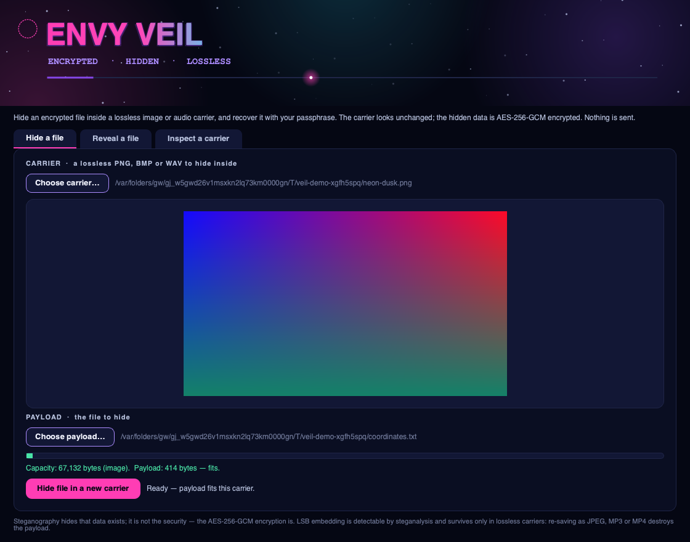
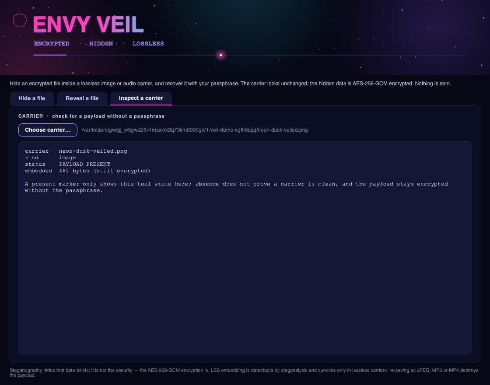

<p align="center">
  
</p>

<p align="center"><b>Hide an encrypted file inside an ordinary-looking image or audio file — then recover it with your passphrase — in a real native app window.</b><br />
AES-256-GCM encryption first, LSB steganography into lossless PNG/BMP/WAV carriers, a live capacity meter, and passphrase-free inspection. From ENVY BLACK VEIL, as a standalone app.</p>

<p align="center">
  <a href="https://github.com/xzchick/envy-veil/actions/workflows/tests.yml"></a>
</p>
<p align="center">
  
  
  <br />
  
  
  
  
</p>

<p align="center">
  <a href="#install"><b>Install</b></a> ·
  <a href="#works-on">Compatibility</a> ·
  <a href="#using-it">Using it</a> ·
  <a href="#honest-by-design">What it isn't</a> ·
  <a href="#build--test">Build</a>
</p>

<p align="center">
  
</p>

<p align="center"><sub>A real native window — not a browser view. The title pulses, the stars twinkle, and a light travels the accent bar.</sub></p>

<a name="features"></a>




Choose a **carrier** — a lossless PNG, BMP or WAV — and a **payload** file. Veil seals the payload in the same **AES-256-GCM** envelope [ENVY Vault](https://github.com/xzchick/envy-vault) uses, then writes the encrypted bytes into the **least-significant bits** of the carrier's pixels or audio samples. The output looks and plays like the original, but carries your hidden, encrypted file. The **capacity meter** shows whether a payload fits before you commit, and nothing is ever overwritten — every result is a new file.

<p align="center">
  
</p>

To get a file back, point Veil at the carrier and enter the passphrase: it reads the bits, decrypts, and writes the recovered file. **Inspect** reports whether a carrier holds a Veil payload without needing the passphrase at all.

<a name="works-on"></a>


<p align="center">
  
  
  
</p>



### Requirements

| | 🍎 macOS | 🪟 Windows | 🐧 Linux |
|---|---|---|---|
| **OS version** | macOS 11 Big Sur or newer | Windows 10 or 11 (64-bit) | A current x86_64 or arm64 desktop |
| **Standalone bundle** | Nothing else to install | Nothing else to install | Standard desktop libraries (X11 or Wayland) |
| **From pip** | Python 3.10+ | Python 3.10+ | Python 3.10+ and a desktop session |
| **Dependencies** | `cryptography`, `Pillow` + Qt (bundled) | same (bundled) | same (bundled) |
| **Network** | None, ever | None, ever | None, ever |

<a name="install"></a>


A **standalone bundle** that needs no Python, or **pip** if you already have Python 3.10+.

### Standalone bundle (no Python) — coming with v0.1.0

When the v0.1.0 release is published, download a bundle from **Releases**:

| File | System | Run it |
|---|---|---|
| `envy-veil-v0.1.0-macos-arm64.tar.gz` | macOS (Apple Silicon) | `tar -xzf` it, then open `envy-veil` |
| `envy-veil-v0.1.0-windows-x86_64.zip` | Windows (64-bit) | Unzip, then run `envy-veil.exe` |
| `envy-veil-v0.1.0-linux-x86_64.tar.gz` | Linux (64-bit) | `tar -xzf` it, then run `./envy-veil` |
| `envy_veil-0.1.0-py3-none-any.whl` | Any OS with Python 3.10+ | `pip install` the wheel |
| `SHA256SUMS.txt` | — | Verify your download first |

Running `envy-veil` with no arguments opens the window.

### From pip (Python 3.10+)

```sh
git clone https://github.com/xzchick/envy-veil.git
cd envy-veil
python3 -m venv .venv
. .venv/bin/activate          # Windows: .venv\Scripts\activate
pip install .
envy-veil                      # opens the window
```

<a name="using-it"></a>


**In the window**

- **Hide a file** → choose a carrier (PNG/BMP/WAV) and a payload, watch the capacity meter, set a passphrase (at least 12 characters), and save a new carrier.
- **Reveal a file** → choose a carrier that holds a payload, enter the passphrase, and save the recovered file.
- **Inspect a carrier** → check whether a file holds a Veil payload, without a passphrase.

**In the terminal**

```sh
envy-veil capacity cover.png                       # how much it can hide
envy-veil hide cover.png secret.pdf out.png        # encrypt + hide -> new carrier
envy-veil inspect out.png                           # is a payload present?
envy-veil reveal out.png recovered.pdf              # decrypt + extract -> new file
```

Every command writes a **new** file and never overwrites the carrier or payload.

<a name="honest-by-design"></a>


The encryption is real: payloads are sealed with **AES-256-GCM** and a key derived from your passphrase with **scrypt**. What Veil does **not** do is just as important:

- **Steganography is concealment, not security.** It hides *that* a file exists. The secrecy of the contents comes from the AES-256-GCM encryption — hiding without it would protect nothing.
- **LSB embedding is detectable.** Statistical steganalysis can flag a carrier as likely modified. Veil hides a message; it does not make one undetectable.
- **Only lossless carriers survive.** PNG, BMP and 16-bit WAV preserve the hidden bits. Re-saving the output as **JPEG, MP3, MP4** or any lossy format — or letting a chat app re-compress it — **destroys the payload**.
- **Capacity is bounded.** A carrier holds about one bit per colour channel or audio sample; the meter shows the limit before you commit.
- **Nothing is sent.** No network, no accounts. Every result is a new local file.

> [!IMPORTANT]
> Keep your passphrase safe. There is no recovery: without it, a hidden payload cannot be decrypted.

<a name="build--test"></a>


```sh
python -m unittest discover -s tests -v          # unit tests (no display needed)
pip install pyinstaller build
python scripts/build_release_bundle.py           # standalone bundle + wheel + sdist + checksums
python scripts/smoke_test_release.py             # launch the built bundle and check it runs
```

CI runs all of this on Ubuntu, Windows and macOS for every push. Regenerate the README artwork with `python scripts/render_readme_art.py`.

<p align="center"><sub>MIT licensed. Part of ENVY BLACK VEIL, packaged as a standalone app. Offline; no telemetry, no network, no accounts.</sub></p>
